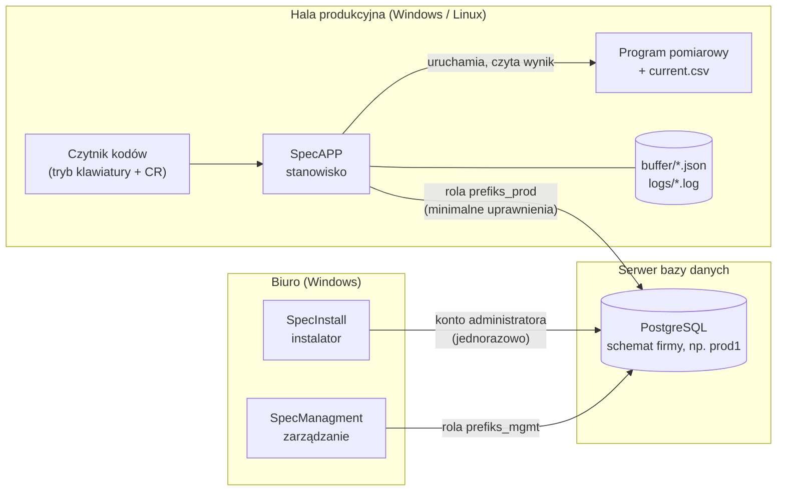
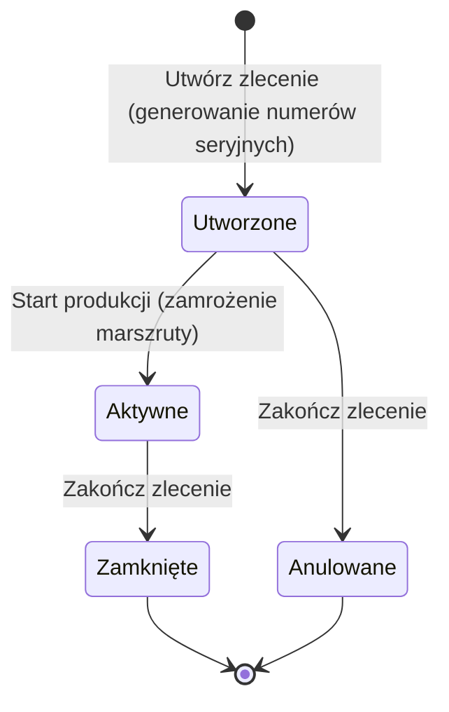
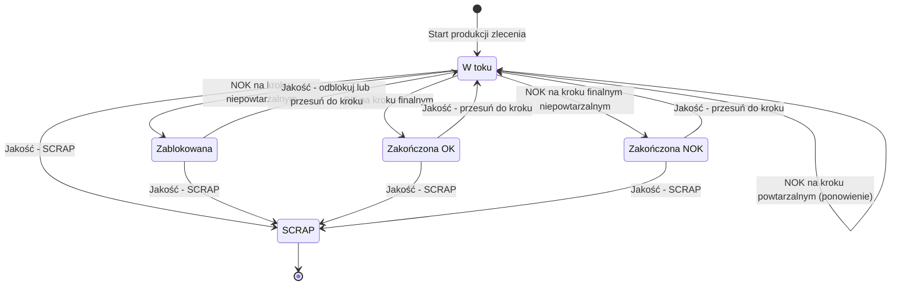
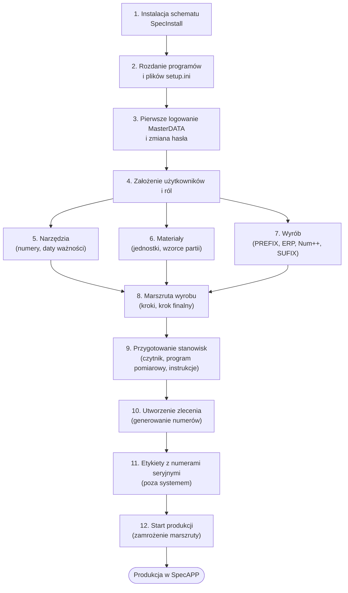
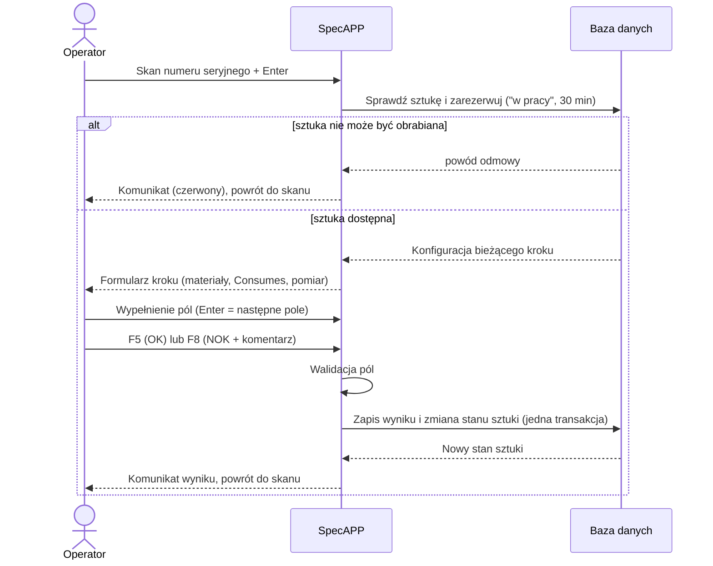
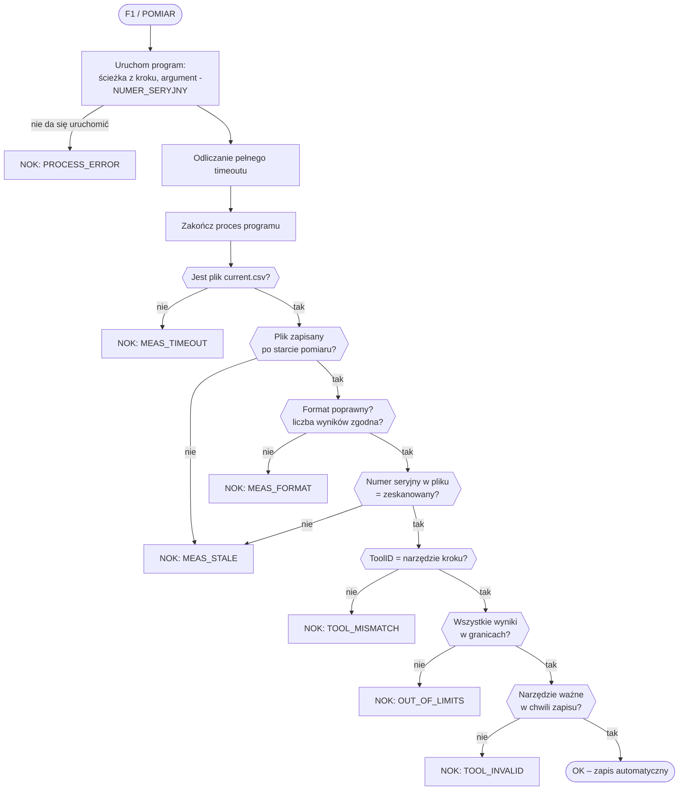
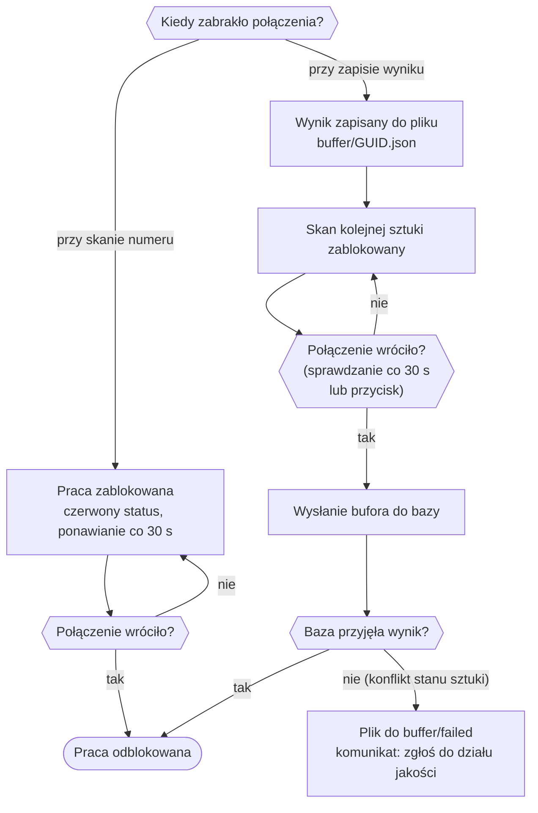
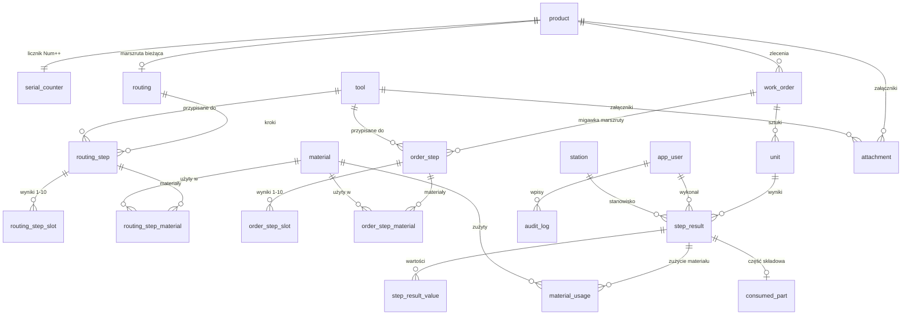

# System śledzenia produkcji SpecAPP / SpecManagment / SpecInstall

**Dokumentacja użytkowa i wdrożeniowa** · wersja dokumentu 1.0 · język: polski (wersja angielska: [Documentation_EN.md](Documentation_EN.md))

Dokument opisuje system w stanie zgodnym z kodem źródłowym repozytorium. Diagramy są zapisane w notacji Mermaid (UML) – wyświetlają je m.in. GitHub, GitLab i Visual Studio Code.

## Spis treści

1. [Przeznaczenie i zakres](#1-przeznaczenie-i-zakres)
2. [Architektura systemu](#2-architektura-systemu)
3. [Wymagania sprzętowe i programowe](#3-wymagania-sprzętowe-i-programowe)
4. [Role i uprawnienia](#4-role-i-uprawnienia)
5. [Słownik pojęć i opis pól](#5-słownik-pojęć-i-opis-pól)
6. [Instalacja – SpecInstall](#6-instalacja--specinstall)
7. [Przygotowanie produkcji krok po kroku](#7-przygotowanie-produkcji-krok-po-kroku)
8. [Praca na stanowisku – SpecAPP](#8-praca-na-stanowisku--specapp)
9. [Pomiar automatyczny i plik current.csv](#9-pomiar-automatyczny-i-plik-currentcsv)
10. [Utrata połączenia i bufor lokalny](#10-utrata-połączenia-i-bufor-lokalny)
11. [Moduł jakości](#11-moduł-jakości)
12. [Dashboard KPI i eksport danych](#12-dashboard-kpi-i-eksport-danych)
13. [Bezpieczeństwo](#13-bezpieczeństwo)
14. [Model danych](#14-model-danych)
15. [Komunikaty i kody błędów](#15-komunikaty-i-kody-błędów)
16. [Listy kontrolne](#16-listy-kontrolne)

---

## 1. Przeznaczenie i zakres

System rejestruje przebieg produkcji każdej sztuki wyrobu (traceability): kto, kiedy, na którym stanowisku, jakim narzędziem i z jakim wynikiem wykonał każdy krok procesu, jakie materiały i części składowe zostały użyte oraz jakie decyzje podjął dział jakości.

System składa się z trzech programów:

| Program | Dla kogo | Do czego służy |
| --- | --- | --- |
| **SpecInstall** | administrator | jednorazowe założenie struktury bazy danych i wygenerowanie plików konfiguracyjnych `setup.ini` |
| **SpecManagment** | planista, technolog, jakość, administrator danych | definiowanie wyrobów, marszrut, zleceń, materiałów, narzędzi i użytkowników; decyzje jakości; KPI; eksport |
| **SpecAPP** | operator produkcji | praca na stanowisku: skan numeru seryjnego, wykonanie kroku, zapis wyniku OK/NOK |

Poza zakresem systemu są: drukowanie etykiet z numerami seryjnymi, sam program pomiarowy (np. `pomiar.exe` – dostarcza go użytkownik) oraz integracja z systemem ERP (pole „WARTOŚĆ ERP” jest wpisywane ręcznie).

## 2. Architektura systemu



Najważniejsze zasady działania:

- **Jedna baza, jeden schemat na firmę.** Każda instalacja tworzy w bazie PostgreSQL osobny schemat o 5-znakowej nazwie (np. `prod1`). Na jednym serwerze może działać wiele niezależnych instalacji.
- **Trzy role bazodanowe.** `<prefiks>_owner` (właściciel tabel, bez prawa logowania), `<prefiks>_mgmt` (SpecManagment) i `<prefiks>_prod` (SpecAPP – tylko odczyt konfiguracji, dopisywanie wyników i zmiana stanu sztuki).
- **Marszruta zamrażana przy starcie zlecenia.** W chwili „Start produkcji” bieżąca marszruta wyrobu jest kopiowana do zlecenia. Późniejsze zmiany marszruty dotyczą dopiero kolejnych zleceń.
- **Formularz stanowiska powstaje z konfiguracji kroku.** SpecAPP nie ma ekranów „na sztywno” – pola materiałów, pomiaru i części składowej pojawiają się zgodnie z definicją kroku.
- **Wyniki są tylko dopisywane.** Wyniku kroku ani wpisu audytu nie można zmienić ani usunąć; korekta to zawsze nowy wpis.

## 3. Wymagania sprzętowe i programowe

### 3.1. Wymagania programowe

| Element | Wymaganie |
| --- | --- |
| Serwer bazy danych | PostgreSQL 14 lub nowszy (system był uruchamiany na wersji 14). Dostęp sieciowy TCP, domyślnie port 5432. |
| Konto do instalacji | Konto PostgreSQL z prawem tworzenia ról i schematów w wybranej bazie (np. superużytkownik lub konto z `CREATEROLE` i prawem `CREATE` na bazie). Potrzebne tylko podczas pracy SpecInstall. |
| SpecInstall, SpecManagment | Windows 10/11 x64, środowisko **.NET Desktop Runtime 8** (lub nowsze). |
| SpecAPP – Windows | Windows 10/11 x64, **.NET Desktop Runtime 8** (lub nowsze). |
| SpecAPP – Linux | Dystrybucja x64 z bibliotekami **GTK 3** i sesją graficzną (X11). Paczka jest samowystarczalna – nie wymaga instalacji .NET. |
| Sieć | Stałe połączenie stanowisk z serwerem bazy. Zapora serwera musi przepuszczać port PostgreSQL z adresów stanowisk (`pg_hba.conf`). |
| Limit połączeń | Każde stanowisko SpecAPP używa najwyżej 2 połączeń, każdy SpecManagment najwyżej 4. Parametr `max_connections` serwera powinien być większy niż `2 × liczba stanowisk + 4 × liczba stanowisk zarządzania` z zapasem. |
| Czas | Znaczniki czasu wyników i ważność narzędzi liczy serwer bazy – zegar serwera musi być poprawny. |

Stan weryfikacji: wersje Windows były testowane na Windows 11; wersja Linux została uruchomiona na Ubuntu (ekran logowania i połączenie z bazą). Ikona okna pod Linuksem może być domyślną ikoną systemu.

### 3.2. Wymagania sprzętowe (zalecenia)

Poniższe wartości są zaleceniami projektowymi – nie wynikają z pomiarów wydajności.

| Element | Zalecenie |
| --- | --- |
| Stanowisko produkcyjne | procesor x64 (2 rdzenie), 4 GB RAM, 500 MB wolnego miejsca na program, logi i bufor; monitor co najmniej 1280 × 800 |
| Stanowisko zarządzania | procesor x64 (2 rdzenie), 8 GB RAM, monitor co najmniej 1366 × 768 (okno startuje w rozmiarze 1280 × 800) |
| Serwer bazy | 2–4 rdzenie, 4–8 GB RAM, dysk SSD, regularna kopia zapasowa bazy |
| Klawiatura | z klawiszami funkcyjnymi F1, F5, F8 i Esc |
| Czytnik kodów | praca w trybie klawiatury (HID), z dopisywanym na końcu znakiem **CR (Enter)**; czytnik nie może obcinać spacji ani zmieniać wielkości liter |

### 3.3. Pliki w folderze programu

| Plik / folder | Program | Znaczenie |
| --- | --- | --- |
| `setup.ini` | SpecAPP, SpecManagment | adres serwera, port, baza, schemat oraz zaszyfrowany login i hasło roli bazodanowej. **Bez tego pliku program się nie uruchomi.** |
| `language.txt` | wszystkie | zapamiętany język interfejsu (`pl` / `en`) |
| `logs/RRRR-MM-DD.log` | SpecAPP, SpecManagment | dziennik lokalny, przechowywany 30 dni |
| `buffer/*.json` | SpecAPP | wyniki oczekujące na wysłanie po utracie połączenia |
| `buffer/failed/` | SpecAPP | wyniki z bufora odrzucone przez bazę (do wyjaśnienia z działem jakości) |

Folder programu musi być zapisywalny dla użytkownika systemu operacyjnego.

## 4. Role i uprawnienia

Każdy użytkownik ma dokładnie jedną rolę. Rola decyduje, do którego programu można się zalogować i które zakładki SpecManagment są widoczne.

| Moduł | Produkcja | Planista | Technolog | Jakość | MasterDATA |
| --- | :---: | :---: | :---: | :---: | :---: |
| **SpecAPP** (stanowisko) | ✔ | – | – | – | ✔ |
| Wyroby | – | zapis | podgląd | podgląd | zapis |
| Marszruty | – | podgląd | zapis | podgląd | zapis |
| Zlecenia | – | zapis | podgląd | podgląd | zapis |
| Dashboard KPI | – | ✔ | ✔ | ✔ | ✔ |
| Jakość | – | – | – | zapis | zapis |
| Eksport | – | ✔ | ✔ | ✔ | ✔ |
| Materiały | – | zapis | zapis | podgląd | zapis |
| Narzędzia | – | podgląd | zapis | zapis | zapis |
| Użytkownicy | – | – | – | – | zapis |

„Podgląd” oznacza, że zakładka jest widoczna (z dopiskiem „(podgląd)”), ale przyciski zapisu są nieaktywne. „–” oznacza brak zakładki.

Zasady logowania:

- Po 5 nieudanych próbach konto jest blokowane na 5 minut. Zapisanie użytkownika w zakładce „Użytkownicy” zdejmuje blokadę.
- Nowe lub zresetowane hasło wymusza zmianę przy pierwszym logowaniu. Hasło musi mieć co najmniej 4 znaki i różnić się od poprzedniego.
- W systemie musi pozostać co najmniej jeden aktywny użytkownik o roli MasterDATA.

## 5. Słownik pojęć i opis pól

### 5.1. Numer seryjny i definicja wyrobu

Każdy wyrób ma własny wzorzec numeru seryjnego:

```
[PREFIX][WARTOŚĆ ERP][Num++][SUFIX]
```

| Pole | Obowiązkowe | Długość | Opis |
| --- | :---: | --- | --- |
| **PREFIX** | tak | 1–50 znaków | Stała część początkowa numeru, zwykle nazwa rodziny wyrobu wraz z separatorem, np. `TELEFON/` lub `TELEFON-`. Separator (ukośnik, myślnik) jest częścią PREFIX-u – system niczego nie dokleja sam. |
| **WARTOŚĆ ERP** | nie | 0–50 znaków | Stała część środkowa, zwykle indeks lub oznaczenie wariantu z systemu ERP, np. `NOKIA10/`. Wpisywana ręcznie. |
| **Num++** | tak | 3–6 cyfr | Licznik sztuk. Podaje się tylko **liczbę cyfr**; numer jest uzupełniany zerami z lewej (`0001`). Licznik zaczyna od 1 i rośnie o 1 dla każdej sztuki. |
| **SUFIX** | nie | 0–50 znaków | Stała część końcowa, np. wersja oprogramowania ` FW1.00`. Spacje są dozwolone i są częścią numeru. |

Przykłady:

| PREFIX | WARTOŚĆ ERP | Num++ | SUFIX | Pierwszy numer |
| --- | --- | :---: | --- | --- |
| `TELEFON/` | `NOKIA10/` | 4 | ` FW1.00` | `TELEFON/NOKIA10/0001 FW1.00` |
| `TELEFON-` | *(puste)* | 4 | *(puste)* | `TELEFON-0001` |

Zasady, o których trzeba pamiętać:

- **Znaki niedozwolone** we wszystkich polach tekstowych: `$ % ^ & ; #` oraz znaki sterujące.
- **Pojemność licznika** wynosi `10^n − 1` sztuk: 3 cyfry = 999, 4 cyfry = 9 999, 5 cyfr = 99 999, 6 cyfr = 999 999. Licznik jest wspólny dla wszystkich zleceń danego wyrobu i nigdy się nie cofa. Zlecenia, które przekroczyłoby pojemność, system nie utworzy – trzeba zdefiniować nowy wyrób (np. z innym PREFIX-em lub dłuższym Num++).
- **Wyrobu nie można zmienić ani usunąć.** Wybranie wyrobu z listy kopiuje jego dane do formularza; po zmianie zapisuje się go jako **nowy** wyrób. Kombinacja PREFIX + WARTOŚĆ ERP + SUFIX + długość Num++ musi być unikalna.
- **Numer seryjny jest unikalny w całym systemie.** Jeśli dwa wyroby dałyby ten sam numer, zlecenie nie zostanie utworzone.
- **Skan numeru na stanowisku** usuwa wyłącznie końcowe CR/LF. Spacje – także końcowe – są częścią numeru, więc etykieta musi odwzorować numer co do znaku.

### 5.2. Zlecenie produkcyjne

| Pole | Opis |
| --- | --- |
| **Numer zlecenia** | Nadawany automatycznie: `ZP-RRRRMMDD-NNN` (data utworzenia i kolejny numer w danym dniu), np. `ZP-20261110-001`. |
| **Wyrób** | Na liście są tylko wyroby ze zdefiniowaną marszrutą. |
| **Wersja BOM** | Obowiązkowa, do 25 znaków. Informacja opisowa o wersji listy materiałowej, zapisywana przy zleceniu i widoczna na stanowisku oraz w eksporcie. |
| **Ilość do produkcji** | Liczba sztuk > 0. Tyle numerów seryjnych zostanie wygenerowanych od razu przy tworzeniu zlecenia. |
| **Przewidywana data startu / ukończenia** | Informacyjne; data startu nie może być późniejsza niż data ukończenia. |
| **Notatki** | Do 1000 znaków. |

Stany zlecenia:



- **Utworzone** – numery seryjne istnieją, ale stanowiska odrzucają ich skan („zlecenie nie zostało jeszcze wystartowane”).
- **Aktywne** – jedyny stan, w którym można pracować nad sztukami i podejmować decyzje jakości.
- **Zamknięte / Anulowane** – operacja nieodwracalna. Niedokończone sztuki zamkniętego zlecenia są trwale zablokowane.

### 5.3. Marszruta i krok

Marszruta to uporządkowana lista kroków wyrobu. Kroki wykonuje się kolejno według numerów; nie ma rozgałęzień.

| Pole kroku | Opis |
| --- | --- |
| **Numer kroku** | Liczba > 0. Zaleca się wielokrotności 10 (10, 20, 30 …), aby można było wstawić krok pomiędzy; przycisk „Nowy krok – podpowiedz numer” proponuje kolejną dziesiątkę. |
| **Opis kroku** | Obowiązkowy tytuł, do 50 znaków. |
| **Treść kroku** | Instrukcja dla operatora wyświetlana na stanowisku, do 500 znaków. |
| **Step duration [s]** | Planowany czas kroku w sekundach. Służy wyłącznie do porównania plan/rzeczywistość w KPI. |
| **Work Instructions** | Ścieżka do pliku instrukcji **widziana ze stanowiska** (do 500 znaków). Na stanowisku pojawia się przycisk „Instrukcja stanowiskowa…”, który otwiera plik domyślnym programem systemu. |
| **Manual measurement** | Pomiar ręczny jednej wartości. Wymaga: LSL ≤ USL, wskazania narzędzia; jednostka (Unit) do 10 znaków. Operator skanuje numer miernika i wpisuje wartość. |
| **Automatic Measurement** | Pomiar wykonywany przez zewnętrzny program (rozdz. 9). Wymaga: ścieżki programu, timeoutu > 0 s, narzędzia oraz 1–10 zdefiniowanych wyników. Wyklucza pomiar ręczny, materiały i Consumes. |
| **Narzędzie** | Przy pomiarze ręcznym – miernik, którego numer operator musi zeskanować. Przy pomiarze automatycznym – ToolID, który musi zwrócić program pomiarowy. |
| **Wyniki 1–10** | Tylko dla pomiaru automatycznego, wypełniane kolejno od 1 bez przerw. Typ „Liczba”: wymagane LSL ≤ USL. Typ „Tekst”: wymagany tekst oczekiwany; porównanie jest dokładne, z rozróżnieniem wielkości liter. |
| **Material declaration** | Do 10 materiałów w kroku: zaznaczenie „Is used?”, materiał z listy, ilość > 0. |
| **Consumes** | Operator skanuje numer części składowej wbudowywanej w sztukę (np. numer PCB). |
| **Repeatable Step?** | Krok powtarzalny: wynik NOK nie blokuje sztuki, operator od razu ponawia krok. |
| **Final Step?** | Krok finalny: wynik OK kończy produkcję sztuki. Marszruta musi mieć dokładnie jeden krok finalny i musi on mieć najwyższy numer. |

Ograniczenia: granice LSL/USL są traktowane włącznie (wartość równa granicy jest poprawna). Łączna liczba akcji w kroku (materiały + pomiar ręczny + Consumes) nie może przekroczyć 10.

Przyciski: **Add** dodaje nowy krok (numer nie może już istnieć), **Update** aktualizuje istniejący krok o podanym numerze, **Usuń krok** usuwa go z marszruty bieżącej. Kroku finalnego nie da się usunąć, dopóki inny krok nie zostanie oznaczony jako finalny.

### 5.4. Materiał

| Pole | Opis |
| --- | --- |
| **Nazwa** | Obowiązkowa, unikalna, do 100 znaków. |
| **Jednostka miary** | Do 10 znaków, np. `g`, `szt`. |
| **Ilość domyślna** | Podpowiadana przy dodawaniu materiału do kroku. |
| **Wzorzec partii** | Opcjonalny wzorzec numeru partii: `*` zastępuje dowolny ciąg znaków, `?` jeden znak. Przykład: `KLEJ*` przyjmie `KLEJ-2026-11`, odrzuci `SR-4471`. Pusty wzorzec = dowolny numer partii. Wielkość liter ma znaczenie. |

### 5.5. Narzędzie (urządzenie pomiarowe)

| Pole | Opis |
| --- | --- |
| **Numer seryjny (ToolID)** | Obowiązkowy, unikalny, do 100 znaków. Dokładnie ten ciąg operator skanuje z miernika lub zwraca program pomiarowy. |
| **Nazwa** | Opis, do 100 znaków. |
| **Ważne od / Ważne do** | Okres ważności, np. świadectwa wzorcowania. Zaznaczenie „bez daty” wyłącza dane ograniczenie. |
| **Aktywne** | Wyłączenie natychmiast unieważnia narzędzie. |
| **Załączniki** | Pliki do 10 MB każdy (np. świadectwo wzorcowania), przechowywane w bazie. |

Narzędzie jest **ważne**, gdy jest aktywne i data serwera mieści się w okresie ważności. Nieważnym narzędziem nie można wykonać pomiaru; ważność jest sprawdzana ponownie w chwili zapisu wyniku.

### 5.6. Sztuka i jej stany

Sztuka (unit) to jeden egzemplarz wyrobu o własnym numerze seryjnym. W każdej chwili ma jeden bieżący krok i jeden stan.



**Znacznik „w pracy”.** Zeskanowanie sztuki rezerwuje ją dla stanowiska na 30 minut – inne stanowisko zobaczy komunikat „Sztuka jest w pracy na stanowisku …”. Znacznik znika po zapisaniu wyniku, po anulowaniu (Esc), po upływie 30 minut albo po ręcznym zdjęciu w module jakości.

## 6. Instalacja – SpecInstall

Instalację wykonuje się raz dla każdej firmy (schematu).

1. Uruchom `SpecInstall.exe` na komputerze z dostępem do serwera bazy.
2. W grupie **Serwer PostgreSQL** wpisz adres IP lub nazwę serwera, port (domyślnie 5432), nazwę bazy danych oraz login i hasło konta administratora.
3. Kliknij **Test połączenia** i upewnij się, że połączenie działa.
4. W grupie **Instalacja** ustaw:
   - **Prefiks bazy** – dokładnie 5 znaków: mała litera, potem małe litery lub cyfry (np. `prod1`). To nazwa schematu.
   - **Użytkownik bazy – produkcja / zarządzanie** – podpowiadane jako `<prefiks>_prod` i `<prefiks>_mgmt`.
   - **Hasła** tych użytkowników – generowane losowo; można je zmienić (co najmniej 8 znaków).
   - **Folder na pliki setup.ini** – domyślnie `setup-output` obok instalatora.
5. Kliknij **Instaluj**. Instalator w jednej transakcji tworzy role, schemat, tabele, uprawnienia i konto aplikacyjne `MasterDATA`. Jeśli cokolwiek się nie powiedzie, w bazie nie zostaje żaden obiekt.
6. Po zakończeniu w folderze wyjściowym są dwa pliki:
   - `SpecAPP\setup.ini` – skopiuj do folderu programu SpecAPP na każdym stanowisku produkcyjnym,
   - `SpecManagment\setup.ini` – skopiuj do folderu programu SpecManagment.

Instalator **nigdy nie nadpisuje** istniejącego schematu ani istniejących ról – w takim przypadku przerywa pracę z komunikatem.

Pliki `setup.ini` zawierają dane dostępowe do bazy (zaszyfrowane). Przekazuj je osobną, zaufaną drogą i nie umieszczaj w repozytoriach ani na udziałach publicznych.

## 7. Przygotowanie produkcji krok po kroku

Poniższa sekwencja musi być wykonana, zanim operator zeskanuje pierwszą sztukę.



### Krok 1–2. Instalacja i dystrybucja

Wykonaj instalację według rozdziału 6. Na każdym komputerze umieść folder programu wraz z właściwym plikiem `setup.ini`. Bez pliku program wyświetli komunikat „Brak pliku setup.ini w folderze aplikacji” i się zamknie.

### Krok 3. Pierwsze logowanie

Uruchom SpecManagment i zaloguj się kontem startowym `MasterDATA` z hasłem startowym podanym w komunikacie końcowym instalatora. System natychmiast wymusi ustawienie własnego hasła. Hasło startowe jest takie samo w każdej instalacji, dlatego zmień je przed udostępnieniem systemu innym osobom.

### Krok 4. Użytkownicy (zakładka „Użytkownicy”, rola MasterDATA)

Dla każdej osoby: **Nowy** → Login (UserID), Imię i nazwisko, Rola, Hasło → **Zapisz**. Każdy użytkownik przy pierwszym logowaniu ustawi własne hasło. Załóż co najmniej: jednego operatora (rola Produkcja), planistę, technologa i osobę z działu jakości. Zaleca się drugie konto MasterDATA jako zapasowe.

### Krok 5. Narzędzia (zakładka „Narzędzia”, technolog lub jakość)

Dla każdego miernika i testera: **Nowe** → Numer seryjny (dokładnie taki, jaki jest zakodowany na etykiecie miernika lub zwracany przez program pomiarowy), Nazwa, daty ważności, „Aktywne” → **Zapisz**. Po zapisie można dołączyć świadectwo wzorcowania.

### Krok 6. Materiały (zakładka „Materiały”, planista lub technolog)

Dla każdego materiału zużywanego w procesie: **Nowy** → Nazwa, Jednostka miary, Ilość domyślna, Wzorzec partii → **Zapisz**.

### Krok 7. Wyrób (zakładka „Wyroby”, planista)

1. Wypełnij PREFIX, WARTOŚĆ ERP, długość Num++ i SUFIX (opis w rozdz. 5.1).
2. Sprawdź pole **Pierwszy numer** – pokazuje dokładnie taki numer, jaki otrzyma pierwsza sztuka.
3. Kliknij **Zapisz jako NOWY wyrób**. Po zapisie można dodać załączniki (np. rysunek).

Przed zapisem upewnij się, że długość Num++ wystarczy na cały planowany wolumen wyrobu – po zapisie nie da się jej zmienić.

### Krok 8. Marszruta (zakładka „Marszruty”, technolog)

1. Wybierz wyrób z listy.
2. Dla każdego kroku: **Nowy krok – podpowiedz numer** → wypełnij pola (rozdz. 5.3) → **Add**.
3. Ostatni krok oznacz jako **Final Step?**.
4. Sprawdź listę kroków u góry: kolejność, rodzaj, narzędzie, znaczniki „Powtarzalny” i „Finalny”.

Warunki, które sprawdzi system przy starcie zlecenia: co najmniej jeden krok, dokładnie jeden krok finalny o najwyższym numerze, poprawność każdego kroku.

### Krok 9. Przygotowanie stanowisk

- **Czytnik kodów:** tryb klawiatury, sufiks CR, bez obcinania spacji; układ klawiatury czytnika zgodny z systemem (znaki takie jak `/` i `-` muszą być przesyłane poprawnie).
- **Program pomiarowy:** na każdym stanowisku wykonującym krok automatyczny program musi znajdować się **dokładnie pod ścieżką wpisaną w kroku**, a jego folder musi być zapisywalny (tam powstaje `current.csv`).
- **Instrukcje stanowiskowe:** plik musi być dostępny pod ścieżką z pola Work Instructions.
- **Kontrola:** uruchom SpecAPP, zaloguj operatora i sprawdź, czy w prawym górnym rogu jest zielony status „● Połączono”.

### Krok 10. Zlecenie (zakładka „Zlecenia”, planista)

Wybierz wyrób, wpisz wersję BOM, ilość, daty i notatki → **Utwórz zlecenie**. System nadaje numer zlecenia i od razu generuje numery seryjne; komunikat podaje pierwszy i ostatni numer.

### Krok 11. Etykiety

System nie drukuje etykiet. Zakres numerów (pierwszy–ostatni) jest widoczny w komunikacie po utworzeniu zlecenia i w statystyce zlecenia; pełną listę numerów daje „Eksport zlecenia” do CSV (kolumna `serial_no`). Etykiety należy wydrukować zewnętrznym narzędziem i nakleić na sztuki.

### Krok 12. Start produkcji

Zaznacz zlecenie na liście → **▶ Start produkcji (wystartuj zlecenie)** → potwierdź. Od tej chwili marszruta zlecenia jest zamrożona, wszystkie sztuki stoją na pierwszym kroku, a stanowiska przyjmują ich numery.

## 8. Praca na stanowisku – SpecAPP

### 8.1. Obsługa klawiaturą i czytnikiem

| Klawisz | Działanie |
| --- | --- |
| **Enter** (CR z czytnika) / **TAB** | przejście do następnego pola |
| **F1** | pomiar automatyczny |
| **F5** | zatwierdzenie wyniku **OK** |
| **F8** | zatwierdzenie wyniku **NOK** (wymaga komentarza) |
| **Esc** | anulowanie bieżącej sztuki i powrót do pola skanu |

Cały cykl da się wykonać bez myszy: skan numeru → skany/wpisy w kolejnych polach (każdy zakończony Enterem) → F5 lub F8.

### 8.2. Przebieg jednego kroku



Opis czynności:

1. **Logowanie.** Operator podaje UserID i hasło. Logować się mogą role Produkcja i MasterDATA.
2. **Skan numeru seryjnego.** Kursor stoi w polu „Numer seryjny”. Po skanie system sprawdza sztukę. Skan zostanie odrzucony z komunikatem, gdy: numer nie istnieje; zlecenie nie jest wystartowane albo jest zamknięte; sztuka jest zablokowana, zakończona lub zezłomowana; sztuka jest w pracy na innym stanowisku.
3. **Formularz kroku.** Wyświetlają się: numer i opis kroku, zlecenie i wersja BOM, treść instrukcji, pasek postępu „Krok X z Y” oraz pola wynikające z konfiguracji:
   - **Materiały** – dla każdego: ilość użyta (podpowiedziana ilość deklarowana) i numer partii (skan). Partia musi pasować do wzorca materiału.
   - **Consumes** – skan numeru części składowej.
   - **Pomiar ręczny** – skan numeru miernika, potem wartość zmierzona. Miernik musi być dokładnie tym narzędziem, które przypisano do kroku, i musi być ważny. Dopuszczalny jest przecinek lub kropka dziesiętna.
   - **Pomiar automatyczny** – przycisk POMIAR (F1); opis w rozdz. 9.
   - **Komentarz** – zawsze dostępny, wymagany przy NOK.
4. **Decyzja.**
   - **F5 – OK.** Wszystkie pola muszą być poprawnie wypełnione, a wartość pomiaru musi mieścić się w granicach. W przeciwnym razie system wskaże błędne pole i nie zapisze wyniku.
   - **F8 – NOK.** Wymagany jest komentarz z przyczyną. Zapisywane są te dane, które zostały poprawnie wypełnione.
5. **Wynik.** Komunikat informuje o skutku:

| Wynik | Krok | Skutek dla sztuki |
| --- | --- | --- |
| OK | niefinalny | przechodzi do następnego kroku |
| OK | finalny | **Zakończona OK** |
| NOK | powtarzalny | pozostaje na kroku; formularz otwiera się ponownie do ponowienia |
| NOK | niepowtarzalny | **Zablokowana** – wymagana decyzja działu jakości |
| NOK | finalny niepowtarzalny | **Zakończona NOK** |

Sztuka może być obrabiana na dowolnym stanowisku – o tym, który krok jest wykonywany, decyduje stan sztuki, a nie stanowisko. Nazwa stanowiska to nazwa komputera, rejestrowana automatycznie.

## 9. Pomiar automatyczny i plik current.csv

Krok z zaznaczonym **Automatic Measurement** nie ma przycisków OK/NOK – wynik wylicza system.



### 9.1. Kontrakt programu pomiarowego

| Element | Wymaganie |
| --- | --- |
| Uruchomienie | SpecAPP uruchamia program ze ścieżki wpisanej w kroku, z folderem roboczym ustawionym na folder programu. |
| Argument | Jeden argument: znak `-` i numer seryjny, np. `-TELEFON/NOKIA10/0001 FW1.00` (spacje w numerze są przekazywane poprawnie). |
| Plik wyniku | `current.csv` **w tym samym folderze co program**, kodowanie UTF-8. |
| Format pierwszej linii | `NUMER_SERYJNY;NUMER_URZĄDZENIA;WYNIK1;…;WYNIKn;#` zakończone znakiem nowej linii (CR, LF lub CRLF). |
| Liczba wyników | Dokładnie tyle, ile wyników zdefiniowano w kroku (1–10). |
| Czas | Plik musi zostać zapisany przed upływem timeoutu. System **zawsze czeka pełny timeout**, a potem kończy proces – timeout jest więc czasem cyklu pomiaru. |

Przykład dla kroku z dwoma wynikami (napięcie 4,9–5,1 V i tekst `OK`):

```
TELEFON/NOKIA10/0001 FW1.00;TESTER-7;5.02;OK;#
```

Wyniki liczbowe muszą mieć kropkę dziesiętną. Końcówka `;#` i znak nowej linii są potwierdzeniem, że plik został zapisany w całości – ich brak oznacza błąd formatu.

## 10. Utrata połączenia i bufor lokalny



- Status połączenia jest widoczny w prawym górnym rogu: zielony „● Połączono”, bursztynowy „● Bufor: N – wysyłanie”, czerwony „● BRAK POŁĄCZENIA – ponawianie co 30 s”. Przycisk **Sprawdź połączenie** wymusza natychmiastową próbę.
- Wynik zapisany do bufora zachowuje rzeczywisty czas wykonania i jest oznaczany w historii jako „Bufor”.
- Każdy wynik ma unikalny identyfikator, więc ponowne wysłanie tego samego wyniku nie tworzy duplikatu.
- Jeżeli nie da się zapisać wyniku ani do bazy, ani do bufora, pojawia się komunikat „BŁĄD KRYTYCZNY” – sztuki nie wolno odkładać; należy ponowić F5/F8.
- Wszystkie zdarzenia (skany, wyniki, odrzucenia, błędy) trafiają do dziennika `logs/RRRR-MM-DD.log` na stanowisku.

## 11. Moduł jakości

Zakładka **Jakość** w SpecManagment (role Jakość i MasterDATA).

1. Zeskanuj lub wpisz numer seryjny i naciśnij Enter. Pole **Gdzie jest teraz** pokaże stan sztuki, bieżący krok, zlecenie, wersję BOM i ewentualny znacznik „W PRACY na …”.
2. Tabela **Historia wyników** pokazuje wszystkie wyniki sztuki (najnowszy na górze): czas, krok, wynik, przyczynę, komentarz, użytkownika, stanowisko, narzędzie, czas trwania i znacznik bufora. Zaznaczenie wiersza pokazuje po prawej wartości pomiarów, materiały z partiami i część składową.
3. Wpisz **komentarz** (obowiązkowy, do 500 znaków) i wybierz decyzję:

| Decyzja | Kiedy | Skutek |
| --- | --- | --- |
| **Odblokuj (ponów krok)** | sztuka zablokowana | wraca do stanu „W toku” na tym samym kroku |
| **Przesuń do kroku** | dowolna sztuka poza SCRAP | cofa sztukę do wybranego wcześniejszego kroku (dla sztuki zakończonej – także do kroku finalnego); historia wyników pozostaje |
| **SCRAP** | dowolna sztuka poza SCRAP | stan końcowy, nieodwracalny; wymaga dodatkowego potwierdzenia |
| **Zdejmij znacznik „w pracy”** | sztuka zarezerwowana przez stanowisko | natychmiast zwalnia rezerwację; nie wymaga komentarza |

Każda decyzja jest zapisywana w dzienniku audytu z użytkownikiem, czasem i komentarzem. Decyzje są możliwe tylko dla sztuk zlecenia aktywnego.

## 12. Dashboard KPI i eksport danych

### 12.1. Wskaźniki zlecenia

| Wskaźnik | Definicja |
| --- | --- |
| OK / NOK / SCRAP / W toku / Zablokowane | liczba sztuk zlecenia w danym stanie; NOK jest pokazywany łącznie ze SCRAP |
| **Czas taktu** | średni odstęp między kolejnymi wynikami OK w zleceniu |
| **Czas zlecenia w stanie otwartym** | od pierwszej operacji do zamknięcia zlecenia (albo do chwili bieżącej) |
| **Średni czas produkcji sztuki** | od pierwszej do ostatniej operacji, tylko dla sztuk zakończonych |
| **Średni czas przejścia między operacjami** | od zakończenia kroku z wynikiem OK do rozpoczęcia kolejnego kroku |
| **Suma ponowień** | liczba wyników ponad pierwszy dla każdej pary sztuka–krok |
| **Usterkowość wyrobu** | udział sztuk NOK, SCRAP i zablokowanych we wszystkich zleceniach danego wyrobu |

Wykresy: stan sztuk w zleceniu, wyniki OK/NOK na krokach, czas kroku planowany a rzeczywisty, średni czas przejścia do kroku.

### 12.2. Eksport

| Eksport | Zawartość | Format |
| --- | --- | --- |
| **Eksport zlecenia – CSV** | jeden wiersz na wynik kroku każdej sztuki: zlecenie, numer seryjny, stan, krok, wynik, kod błędu, komentarz, użytkownik, stanowisko, narzędzie, czasy, wartości 1–10, materiały z partiami, część składowa | UTF-8 z BOM, separator `;`, kropka dziesiętna |
| **Raport Excel** | arkusze: KPI, Kroki (plan / rzeczywistość / OK / NOK), Dane (jak CSV) | `.xlsx` |
| **Eksport numeru seryjnego – CSV** | komplet wyników jednej sztuki oraz decyzje jakości z dziennika audytu | jak wyżej |

## 13. Bezpieczeństwo

- **Minimalne uprawnienia stanowiska.** Rola bazodanowa produkcji może czytać konfigurację zlecenia, dopisywać wyniki i zmieniać wyłącznie pola stanu sztuki. Nie ma prawa usuwania danych ani dostępu do tabeli użytkowników.
- **Hasła użytkowników** są przechowywane jako skróty PBKDF2-SHA256 z solą. Logowanie odbywa się przez funkcje bazy, bez wglądu aplikacji w tabelę użytkowników.
- **Plik `setup.ini`** zawiera login i hasło roli bazodanowej zaszyfrowane algorytmem AES-256-GCM. Klucz jest wbudowany w program, dlatego plik należy chronić tak jak hasło: nie udostępniać go osobom postronnym i nie przechowywać w repozytoriach.
- **Niezmienność danych.** Wyniki kroków, zużycie materiałów, części składowe i dziennik audytu można tylko dopisywać. Wyrobu nie można zmienić ani usunąć.
- **Audyt.** Zapisywane są m.in.: utworzenie, start i zamknięcie zlecenia, zmiany kroków marszruty, decyzje jakości oraz błędy krytyczne stanowisk.
- **Zalecenia eksploatacyjne:** zmień hasło startowe MasterDATA od razu po instalacji; ogranicz dostęp sieciowy do portu PostgreSQL do adresów stanowisk; wykonuj regularną kopię zapasową bazy; do instalacji używaj konta administratora, którego hasło nie jest znane użytkownikom systemu.

## 14. Model danych

Uproszczony diagram powiązań tabel schematu (22 tabele; pominięto `schema_version`).



## 15. Komunikaty i kody błędów

### 15.1. Kody zapisywane przy wyniku NOK

| Kod | Znaczenie | Typowa przyczyna i postępowanie |
| --- | --- | --- |
| `OUT_OF_LIMITS` | wynik poza granicami | wartość poza LSL/USL lub tekst inny niż oczekiwany |
| `MEAS_TIMEOUT` | brak pliku `current.csv` po upływie czasu | program pomiarowy nie zdążył lub się zawiesił; sprawdź timeout kroku i program |
| `MEAS_FORMAT` | zły format `current.csv` | brak `;#` lub znaku nowej linii, zła liczba wyników |
| `MEAS_STALE` | stary lub obcy plik `current.csv` | plik pochodzi z poprzedniego pomiaru albo dotyczy innego numeru seryjnego |
| `TOOL_MISMATCH` | narzędzie niezgodne z marszrutą | program zwrócił inny ToolID niż przypisany do kroku |
| `TOOL_INVALID` | narzędzie nieważne | narzędzie nieaktywne lub poza datami ważności; zaktualizuj dane narzędzia |
| `PROCESS_ERROR` | nie można uruchomić programu pomiarowego | zła ścieżka w kroku lub brak programu na stanowisku |

### 15.2. Najczęstsze komunikaty stanowiska

| Komunikat | Co zrobić |
| --- | --- |
| Numer seryjny … nie istnieje w systemie | sprawdź etykietę i ustawienia czytnika (spacje, układ klawiatury) |
| Zlecenie … nie zostało jeszcze wystartowane przez planistę | planista musi kliknąć „Start produkcji” |
| Zlecenie … jest zamknięte – praca nad sztuką jest zablokowana | zlecenia nie da się otworzyć ponownie; decyzja po stronie planisty i jakości |
| Sztuka ZABLOKOWANA po wyniku NOK … | przekaż sztukę do działu jakości |
| Sztuka jest w pracy na stanowisku … | zakończ lub anuluj pracę na tamtym stanowisku, odczekaj 30 minut albo poproś jakość o zdjęcie znacznika |
| Konflikt: stan sztuki zmienił się od momentu skanu | zeskanuj numer ponownie |
| Bufor lokalny nie został jeszcze wysłany do bazy | poczekaj na powrót połączenia lub kliknij „Sprawdź połączenie” |
| Brak pliku setup.ini w folderze aplikacji | skopiuj właściwy plik `setup.ini` z instalatora |

## 16. Listy kontrolne

### 16.1. Przed pierwszym uruchomieniem systemu

- [ ] Serwer PostgreSQL działa i jest osiągalny ze wszystkich stanowisk.
- [ ] SpecInstall zakończył instalację bez błędu.
- [ ] Pliki `setup.ini` skopiowane: SpecAPP na każde stanowisko, SpecManagment na stanowiska biurowe.
- [ ] Hasło startowe MasterDATA zmienione.
- [ ] Założeni użytkownicy z właściwymi rolami.
- [ ] Skonfigurowana kopia zapasowa bazy.

### 16.2. Przed startem każdego zlecenia

- [ ] Wyrób zdefiniowany, „Pierwszy numer” zgodny z oczekiwaniem.
- [ ] Wszystkie narzędzia użyte w marszrucie są aktywne i w okresie ważności.
- [ ] Materiały zdefiniowane, wzorce partii zgodne z rzeczywistym oznaczeniem partii.
- [ ] Marszruta kompletna, ostatni krok oznaczony jako finalny.
- [ ] Program pomiarowy i instrukcje stanowiskowe dostępne pod ścieżkami z marszruty na właściwych stanowiskach.
- [ ] Zlecenie utworzone, etykiety z numerami seryjnymi wydrukowane.
- [ ] Kliknięto „Start produkcji”.
- [ ] Próbny skan pierwszej sztuki otwiera pierwszy krok.

### 16.3. Na początku zmiany (operator)

- [ ] SpecAPP uruchomiony, zalogowany właściwy operator.
- [ ] Status „● Połączono”.
- [ ] Czytnik kodów wpisuje numer i automatycznie przechodzi dalej (CR).
- [ ] Mierniki na stanowisku mają czytelne etykiety z numerem.
