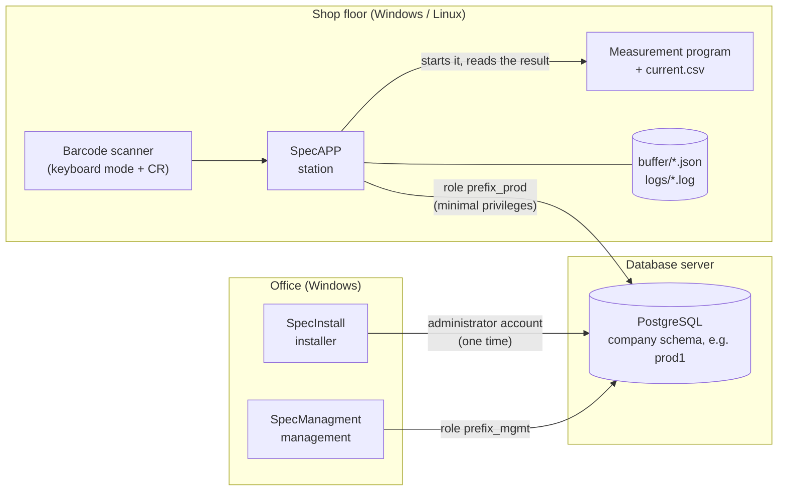
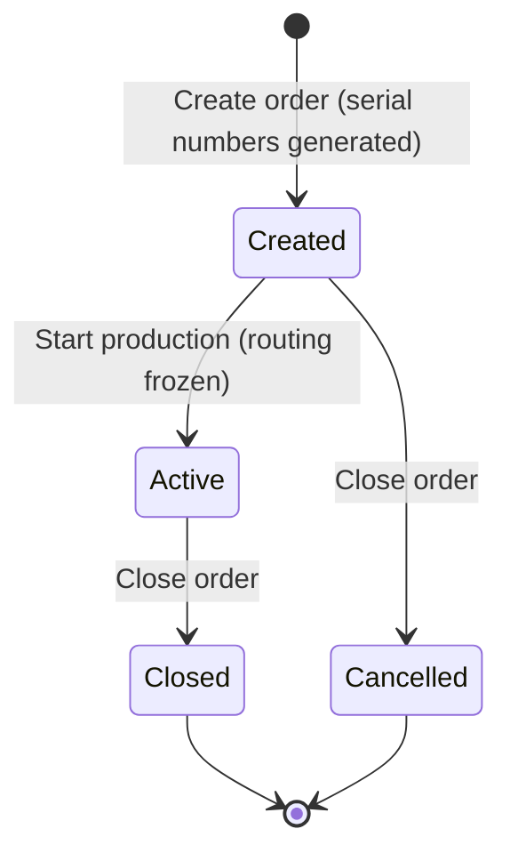
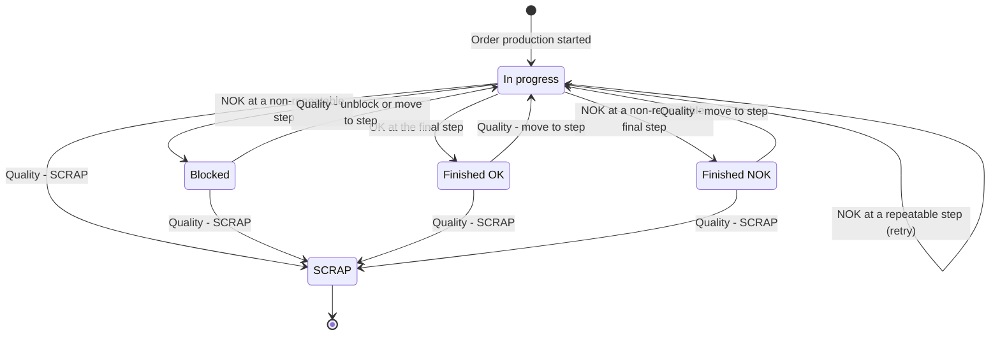
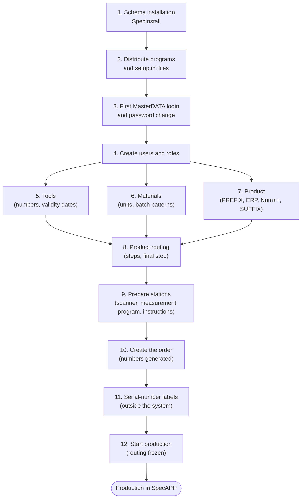
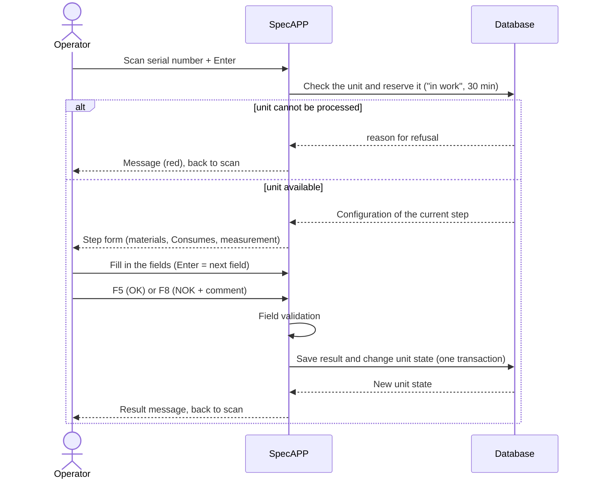
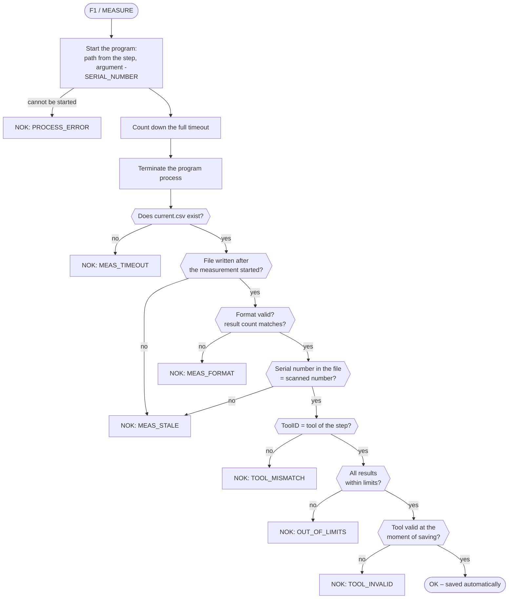
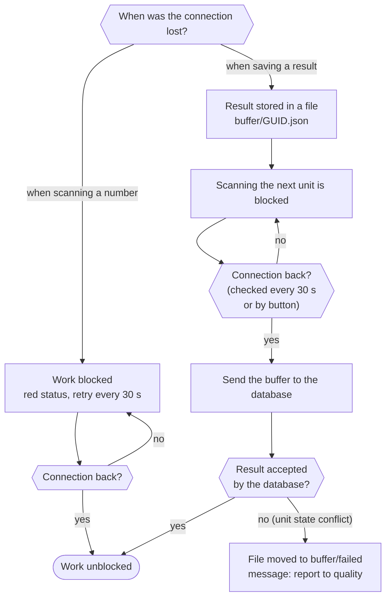
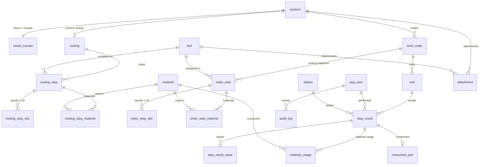

# SpecAPP / SpecManagment / SpecInstall production traceability system

**User and deployment documentation** · document version 1.0 · language: English (Polish version: [Dokumentacja_PL.md](Dokumentacja_PL.md))

This document describes the system as implemented in the source code of this repository. Diagrams use Mermaid (UML) notation, rendered by GitHub, GitLab and Visual Studio Code among others.

## Contents

1. [Purpose and scope](#1-purpose-and-scope)
2. [System architecture](#2-system-architecture)
3. [Hardware and software requirements](#3-hardware-and-software-requirements)
4. [Roles and permissions](#4-roles-and-permissions)
5. [Glossary and field reference](#5-glossary-and-field-reference)
6. [Installation – SpecInstall](#6-installation--specinstall)
7. [Preparing production step by step](#7-preparing-production-step-by-step)
8. [Working at the station – SpecAPP](#8-working-at-the-station--specapp)
9. [Automatic measurement and the current.csv file](#9-automatic-measurement-and-the-currentcsv-file)
10. [Connection loss and the local buffer](#10-connection-loss-and-the-local-buffer)
11. [Quality module](#11-quality-module)
12. [KPI dashboard and data export](#12-kpi-dashboard-and-data-export)
13. [Security](#13-security)
14. [Data model](#14-data-model)
15. [Messages and error codes](#15-messages-and-error-codes)
16. [Checklists](#16-checklists)

---

## 1. Purpose and scope

The system records the production history of every unit of a product (traceability): who performed each process step, when, at which station, with which tool and with what result; which materials and components were used; and which decisions the quality department made.

The system consists of three programs:

| Program | For whom | Purpose |
| --- | --- | --- |
| **SpecInstall** | administrator | one-time creation of the database structure and generation of the `setup.ini` configuration files |
| **SpecManagment** | planner, technologist, quality, master-data administrator | defining products, routings, orders, materials, tools and users; quality decisions; KPI; export |
| **SpecAPP** | production operator | station work: scan a serial number, perform the step, store the OK/NOK result |

Out of scope: printing serial-number labels, the measurement program itself (e.g. `pomiar.exe` – supplied by the user) and ERP integration (the "ERP VALUE" field is typed in manually).

## 2. System architecture



Key principles:

- **One database, one schema per company.** Each installation creates a separate schema with a 5-character name (e.g. `prod1`) in a PostgreSQL database. Several independent installations can share one server.
- **Three database roles.** `<prefix>_owner` (owns the tables, cannot log in), `<prefix>_mgmt` (SpecManagment) and `<prefix>_prod` (SpecAPP – reads configuration, appends results and changes unit state only).
- **The routing is frozen when the order starts.** At "Start production" the current product routing is copied into the order. Later routing changes apply to subsequent orders only.
- **The station form is built from the step configuration.** SpecAPP has no hard-coded screens – material, measurement and component fields appear according to the step definition.
- **Results are append-only.** A step result or an audit entry can never be changed or deleted; a correction is always a new entry.

## 3. Hardware and software requirements

### 3.1. Software requirements

| Item | Requirement |
| --- | --- |
| Database server | PostgreSQL 14 or newer (the system has been run on version 14). TCP network access, port 5432 by default. |
| Installation account | A PostgreSQL account allowed to create roles and schemas in the chosen database (e.g. a superuser, or an account with `CREATEROLE` and the `CREATE` privilege on the database). Needed only while SpecInstall runs. |
| SpecInstall, SpecManagment | Windows 10/11 x64 with **.NET Desktop Runtime 8** (or newer). |
| SpecAPP – Windows | Windows 10/11 x64 with **.NET Desktop Runtime 8** (or newer). |
| SpecAPP – Linux | An x64 distribution with **GTK 3** libraries and a graphical session (X11). The package is self-contained – no .NET installation is required. |
| Network | Permanent connection between stations and the database server. The server firewall and `pg_hba.conf` must allow the PostgreSQL port from the station addresses. |
| Connection limit | Each SpecAPP station uses at most 2 connections, each SpecManagment at most 4. The server `max_connections` should exceed `2 × stations + 4 × management seats`, with a margin. |
| Time | Result timestamps and tool validity are evaluated by the database server – its clock must be correct. |

Verification status: the Windows versions were tested on Windows 11; the Linux version has been started on Ubuntu (login screen and database connection). On Linux the window icon may be the system default.

### 3.2. Hardware requirements (recommendations)

The values below are design recommendations – they do not come from performance measurements.

| Item | Recommendation |
| --- | --- |
| Production station | x64 CPU (2 cores), 4 GB RAM, 500 MB free disk space for the program, logs and buffer; display at least 1280 × 800 |
| Management seat | x64 CPU (2 cores), 8 GB RAM, display at least 1366 × 768 (the window opens at 1280 × 800) |
| Database server | 2–4 cores, 4–8 GB RAM, SSD storage, regular database backup |
| Keyboard | with function keys F1, F5, F8 and Esc |
| Barcode scanner | keyboard (HID) mode with a trailing **CR (Enter)**; the scanner must not trim spaces or change letter case |

### 3.3. Files in the program folder

| File / folder | Program | Meaning |
| --- | --- | --- |
| `setup.ini` | SpecAPP, SpecManagment | server address, port, database, schema and the encrypted login and password of the database role. **The program does not start without this file.** |
| `language.txt` | all | remembered interface language (`pl` / `en`) |
| `logs/YYYY-MM-DD.log` | SpecAPP, SpecManagment | local log, kept for 30 days |
| `buffer/*.json` | SpecAPP | results waiting to be sent after a connection loss |
| `buffer/failed/` | SpecAPP | buffered results rejected by the database (to be clarified with quality) |

The program folder must be writable for the operating-system user.

## 4. Roles and permissions

Every user has exactly one role. The role determines which program the user can log in to and which SpecManagment tabs are visible.

| Module | Production | Planner | Technologist | Quality | MasterDATA |
| --- | :---: | :---: | :---: | :---: | :---: |
| **SpecAPP** (station) | ✔ | – | – | – | ✔ |
| Products | – | write | read-only | read-only | write |
| Routings | – | read-only | write | read-only | write |
| Orders | – | write | read-only | read-only | write |
| KPI Dashboard | – | ✔ | ✔ | ✔ | ✔ |
| Quality | – | – | – | write | write |
| Export | – | ✔ | ✔ | ✔ | ✔ |
| Materials | – | write | write | read-only | write |
| Tools | – | read-only | write | write | write |
| Users | – | – | – | – | write |

"Read-only" means the tab is visible (marked "(read-only)") but its save buttons are disabled. "–" means the tab is not shown.

Login rules:

- After 5 failed attempts the account is locked for 5 minutes. Saving the user in the "Users" tab clears the lock.
- A new or reset password forces a change at first login. A password must have at least 4 characters and differ from the previous one.
- At least one active MasterDATA user must always remain in the system.

## 5. Glossary and field reference

### 5.1. Serial number and product definition

Every product has its own serial-number pattern:

```
[PREFIX][ERP VALUE][Num++][SUFFIX]
```

| Field | Required | Length | Description |
| --- | :---: | --- | --- |
| **PREFIX** | yes | 1–50 characters | The fixed leading part of the number, usually the product family name including its separator, e.g. `TELEFON/` or `TELEFON-`. The separator (slash, hyphen) is part of the PREFIX – the system adds nothing by itself. |
| **ERP VALUE** | no | 0–50 characters | The fixed middle part, usually an item code or variant designation from the ERP system, e.g. `NOKIA10/`. Typed in manually. |
| **Num++** | yes | 3–6 digits | The unit counter. Only the **number of digits** is specified; the number is left-padded with zeros (`0001`). The counter starts at 1 and increases by 1 for each unit. |
| **SUFFIX** | no | 0–50 characters | The fixed trailing part, e.g. a firmware version ` FW1.00`. Spaces are allowed and are part of the number. |

Examples:

| PREFIX | ERP VALUE | Num++ | SUFFIX | First number |
| --- | --- | :---: | --- | --- |
| `TELEFON/` | `NOKIA10/` | 4 | ` FW1.00` | `TELEFON/NOKIA10/0001 FW1.00` |
| `TELEFON-` | *(empty)* | 4 | *(empty)* | `TELEFON-0001` |

Rules to keep in mind:

- **Forbidden characters** in all text fields: `$ % ^ & ; #` and control characters.
- **Counter capacity** is `10^n − 1` units: 3 digits = 999, 4 digits = 9,999, 5 digits = 99,999, 6 digits = 999,999. The counter is shared by all orders of the product and never goes back. The system refuses to create an order that would exceed the capacity – a new product must be defined (e.g. with another PREFIX or a longer Num++).
- **A product cannot be changed or deleted.** Selecting a product in the list copies its data into the form; after changing it you save it as a **new** product. The combination PREFIX + ERP VALUE + SUFFIX + Num++ length must be unique.
- **A serial number is unique across the whole system.** If two products would produce the same number, the order is not created.
- **Scanning at the station** strips trailing CR/LF only. Spaces – including trailing ones – are part of the number, so the label must reproduce the number character for character.

### 5.2. Production order

| Field | Description |
| --- | --- |
| **Order number** | Assigned automatically: `ZP-YYYYMMDD-NNN` (creation date and a sequence number within that day), e.g. `ZP-20261110-001`. |
| **Product** | Only products with a defined routing are listed. |
| **BOM version** | Required, up to 25 characters. Descriptive information about the bill-of-materials version, stored with the order and shown at the station and in exports. |
| **Quantity to produce** | Number of units > 0. That many serial numbers are generated immediately when the order is created. |
| **Planned start / end date** | Informational; the start date must not be later than the end date. |
| **Notes** | Up to 1000 characters. |

Order states:



- **Created** – the serial numbers exist, but stations reject them ("order has not been started yet").
- **Active** – the only state in which units can be processed and quality decisions made.
- **Closed / Cancelled** – irreversible. Unfinished units of a closed order are blocked permanently.

### 5.3. Routing and step

A routing is the ordered list of steps of a product. Steps are performed in step-number order; there is no branching.

| Step field | Description |
| --- | --- |
| **Step number** | A number > 0. Multiples of 10 (10, 20, 30 …) are recommended so that a step can be inserted in between; the "New step – suggest number" button proposes the next multiple of ten. |
| **Step title** | Required, up to 50 characters. |
| **Step body** | The operator instruction shown at the station, up to 500 characters. |
| **Step duration [s]** | Planned step time in seconds. Used only for the planned-versus-actual comparison in KPI. |
| **Work Instructions** | Path to the instruction file **as seen from the station** (up to 500 characters). The station shows a "Work instruction…" button that opens the file with the system default application. |
| **Manual measurement** | Manual measurement of one value. Requires LSL ≤ USL and a tool; the unit is up to 10 characters. The operator scans the meter number and types the value. |
| **Automatic Measurement** | A measurement performed by an external program (section 9). Requires the program path, a timeout > 0 s, a tool and 1–10 defined results. Excludes manual measurement, materials and Consumes. |
| **Tool** | For manual measurement – the meter whose number the operator must scan. For automatic measurement – the ToolID that the measurement program must return. |
| **Results 1–10** | Automatic measurement only, filled consecutively from 1 with no gaps. Type "Number": LSL ≤ USL required. Type "Text": an expected text is required; the comparison is exact and case-sensitive. |
| **Material declaration** | Up to 10 materials per step: tick "Is used?", choose the material, enter a quantity > 0. |
| **Consumes** | The operator scans the number of a component built into the unit (e.g. a PCB number). |
| **Repeatable Step?** | A NOK result does not block the unit; the operator repeats the step immediately. |
| **Final Step?** | An OK result finishes production of the unit. A routing must have exactly one final step, and it must have the highest number. |

Constraints: LSL/USL limits are inclusive (a value equal to a limit passes). The total number of actions in a step (materials + manual measurement + Consumes) must not exceed 10.

Buttons: **Add** creates a new step (the number must not exist yet), **Update** updates the existing step with the given number, **Delete step** removes it from the current routing. The final step cannot be deleted until another step is marked as final.

### 5.4. Material

| Field | Description |
| --- | --- |
| **Name** | Required, unique, up to 100 characters. |
| **Unit of measure** | Up to 10 characters, e.g. `g`, `pcs`. |
| **Default quantity** | Suggested when the material is added to a step. |
| **Batch pattern** | Optional batch-number pattern: `*` stands for any sequence of characters, `?` for one character. Example: `KLEJ*` accepts `KLEJ-2026-11` and rejects `SR-4471`. An empty pattern accepts any batch number. Matching is case-sensitive. |

### 5.5. Tool (measuring device)

| Field | Description |
| --- | --- |
| **Serial number (ToolID)** | Required, unique, up to 100 characters. Exactly this string is scanned from the meter or returned by the measurement program. |
| **Name** | Description, up to 100 characters. |
| **Valid from / Valid to** | Validity period, e.g. of the calibration certificate. Ticking "no date" disables the respective bound. |
| **Active** | Unticking it invalidates the tool immediately. |
| **Attachments** | Files up to 10 MB each (e.g. a calibration certificate), stored in the database. |

A tool is **valid** when it is active and the server date falls within the validity period. An invalid tool cannot be used for a measurement; validity is checked again at the moment the result is saved.

### 5.6. Unit and its states

A unit is one item of a product with its own serial number. At any time it has one current step and one state.



**"In work" lock.** Scanning a unit reserves it for the station for 30 minutes – another station gets the message "The unit is in work at station …". The lock is removed when the result is saved, when the unit is cancelled (Esc), after 30 minutes, or manually in the quality module.

## 6. Installation – SpecInstall

Installation is performed once per company (schema).

1. Start `SpecInstall.exe` on a computer that can reach the database server.
2. In the **PostgreSQL server** group enter the IP address or host name, the port (5432 by default), the database name and the administrator login and password.
3. Click **Test connection** and make sure the connection works.
4. In the **Installation** group set:
   - **Database prefix** – exactly 5 characters: a lowercase letter followed by lowercase letters or digits (e.g. `prod1`). This is the schema name.
   - **DB user – production / management** – suggested as `<prefix>_prod` and `<prefix>_mgmt`.
   - **Passwords** of these users – generated randomly; they can be changed (at least 8 characters).
   - **Folder for setup.ini files** – by default `setup-output` next to the installer.
5. Click **Install**. In a single transaction the installer creates the roles, schema, tables, privileges and the `MasterDATA` application account. If anything fails, no object is left in the database.
6. Afterwards the output folder contains two files:
   - `SpecAPP\setup.ini` – copy it to the SpecAPP program folder on every production station,
   - `SpecManagment\setup.ini` – copy it to the SpecManagment program folder.

The installer **never overwrites** an existing schema or existing roles – in that case it stops with a message.

The `setup.ini` files contain (encrypted) database credentials. Hand them over through a separate, trusted channel and never place them in repositories or on public shares.

## 7. Preparing production step by step

The following sequence must be completed before an operator scans the first unit.



### Steps 1–2. Installation and distribution

Install according to section 6. Place the program folder with the correct `setup.ini` file on every computer. Without the file the program shows "File setup.ini is missing in the application folder" and exits.

### Step 3. First login

Start SpecManagment and log in with the initial `MasterDATA` account and the initial password shown in the installer's final message. The system immediately forces you to set your own password. The initial password is the same in every installation, so change it before giving anyone else access to the system.

### Step 4. Users ("Users" tab, MasterDATA role)

For each person: **New** → Login (UserID), Full name, Role, Password → **Save**. Every user sets their own password at first login. Create at least one operator (Production role), a planner, a technologist and a quality user. A second MasterDATA account is recommended as a spare.

### Step 5. Tools ("Tools" tab, technologist or quality)

For each meter and tester: **New** → Serial number (exactly as encoded on the meter label or returned by the measurement program), Name, validity dates, "Active" → **Save**. After saving you can attach the calibration certificate.

### Step 6. Materials ("Materials" tab, planner or technologist)

For each material consumed in the process: **New** → Name, Unit of measure, Default quantity, Batch pattern → **Save**.

### Step 7. Product ("Products" tab, planner)

1. Fill in PREFIX, ERP VALUE, Num++ length and SUFFIX (see section 5.1).
2. Check the **First number** field – it shows exactly the number the first unit will receive.
3. Click **Save as NEW product**. After saving you can add attachments (e.g. a drawing).

Before saving, make sure the Num++ length covers the whole planned volume of the product – it cannot be changed afterwards.

### Step 8. Routing ("Routings" tab, technologist)

1. Choose the product.
2. For each step: **New step – suggest number** → fill in the fields (section 5.3) → **Add**.
3. Mark the last step as **Final Step?**.
4. Review the step list at the top: order, kind, tool, "Repeatable" and "Final" marks.

Conditions checked by the system when the order is started: at least one step, exactly one final step with the highest number, every step valid.

### Step 9. Prepare the stations

- **Barcode scanner:** keyboard mode, CR suffix, no space trimming; the scanner keyboard layout must match the system (characters such as `/` and `-` must arrive correctly).
- **Measurement program:** on every station performing an automatic step the program must be located **exactly at the path entered in the step**, and its folder must be writable (`current.csv` is created there).
- **Work instructions:** the file must be reachable at the path from the Work Instructions field.
- **Check:** start SpecAPP, log the operator in and verify the green "● Connected" status in the top-right corner.

### Step 10. Order ("Orders" tab, planner)

Choose the product, enter the BOM version, quantity, dates and notes → **Create order**. The system assigns the order number and generates the serial numbers at once; the message shows the first and last number.

### Step 11. Labels

The system does not print labels. The number range (first–last) is shown in the message after order creation and in the order statistics; the full list is available through "Order export" to CSV (column `serial_no`). Print the labels with an external tool and attach them to the units.

### Step 12. Start production

Select the order in the list → **▶ Start production (start order)** → confirm. From this moment the order routing is frozen, all units stand at the first step and stations accept their numbers.

## 8. Working at the station – SpecAPP

### 8.1. Keyboard and scanner operation

| Key | Action |
| --- | --- |
| **Enter** (CR from the scanner) / **TAB** | move to the next field |
| **F1** | automatic measurement |
| **F5** | confirm result **OK** |
| **F8** | confirm result **NOK** (a comment is required) |
| **Esc** | cancel the current unit and return to the scan field |

The whole cycle can be done without a mouse: scan the number → scan/type into the following fields (each ended with Enter) → F5 or F8.

### 8.2. Flow of a single step



Description of activities:

1. **Login.** The operator enters the UserID and password. The Production and MasterDATA roles can log in.
2. **Scan the serial number.** The cursor is in the "Serial number" field. After the scan the system checks the unit. The scan is rejected with a message when: the number does not exist; the order is not started or is closed; the unit is blocked, finished or scrapped; the unit is in work at another station.
3. **Step form.** The form shows the step number and title, the order and BOM version, the instruction text, a "Step X of Y" progress bar and the fields resulting from the configuration:
   - **Materials** – for each: quantity used (pre-filled with the declared quantity) and batch number (scan). The batch must match the material pattern.
   - **Consumes** – scan of the component number.
   - **Manual measurement** – scan the meter number, then type the measured value. The meter must be exactly the tool assigned to the step and must be valid. A decimal comma or point is accepted.
   - **Automatic measurement** – the MEASURE button (F1); see section 9.
   - **Comment** – always available, required for NOK.
4. **Decision.**
   - **F5 – OK.** All fields must be filled in correctly and the measured value must be within limits. Otherwise the system points to the faulty field and does not save the result.
   - **F8 – NOK.** A comment with the reason is required. The data that was entered correctly is saved.
5. **Outcome.** A message states the effect:

| Result | Step | Effect on the unit |
| --- | --- | --- |
| OK | non-final | moves to the next step |
| OK | final | **Finished OK** |
| NOK | repeatable | stays at the step; the form reopens for a retry |
| NOK | non-repeatable | **Blocked** – a quality decision is required |
| NOK | final, non-repeatable | **Finished NOK** |

A unit can be processed at any station – the step to be performed is determined by the unit state, not by the station. The station name is the computer name, registered automatically.

## 9. Automatic measurement and the current.csv file

A step with **Automatic Measurement** ticked has no OK/NOK buttons – the result is computed by the system.



### 9.1. Measurement program contract

| Item | Requirement |
| --- | --- |
| Start | SpecAPP starts the program from the path entered in the step, with the working directory set to the program folder. |
| Argument | A single argument: the character `-` followed by the serial number, e.g. `-TELEFON/NOKIA10/0001 FW1.00` (spaces in the number are passed correctly). |
| Result file | `current.csv` **in the same folder as the program**, UTF-8 encoded. |
| First-line format | `SERIAL_NUMBER;DEVICE_NUMBER;RESULT1;…;RESULTn;#` terminated by a newline (CR, LF or CRLF). |
| Number of results | Exactly as many as defined in the step (1–10). |
| Timing | The file must be written before the timeout elapses. The system **always waits the full timeout** and then terminates the process – the timeout is therefore the measurement cycle time. |

Example for a step with two results (voltage 4.9–5.1 V and the text `OK`):

```
TELEFON/NOKIA10/0001 FW1.00;TESTER-7;5.02;OK;#
```

Numeric results must use a decimal point. The trailing `;#` and the newline confirm that the file was written completely – without them the file is treated as a format error.

## 10. Connection loss and the local buffer



- The connection status is shown in the top-right corner: green "● Connected", amber "● Buffer: N – sending", red "● NO CONNECTION – retrying every 30 s". The **Check connection** button forces an immediate attempt.
- A buffered result keeps its real execution time and is marked as "Buffered" in the history.
- Every result has a unique identifier, so sending the same result again never creates a duplicate.
- If the result can be stored neither in the database nor in the buffer, a "CRITICAL ERROR" message appears – the unit must not be put aside; repeat F5/F8.
- All events (scans, results, rejections, errors) are written to the station log `logs/YYYY-MM-DD.log`.

## 11. Quality module

The **Quality** tab in SpecManagment (Quality and MasterDATA roles).

1. Scan or type the serial number and press Enter. The **Where it is now** field shows the unit state, current step, order, BOM version and an "IN WORK at …" mark if present.
2. The **Result history** table lists all results of the unit (latest on top): time, step, result, reason, comment, user, station, tool, duration and the buffered mark. Selecting a row shows measurement values, materials with batches and the component on the right.
3. Enter a **comment** (required, up to 500 characters) and choose a decision:

| Decision | When | Effect |
| --- | --- | --- |
| **Unblock (retry step)** | unit is blocked | returns to "In progress" at the same step |
| **Move to step** | any unit except SCRAP | moves the unit back to the selected earlier step (for a finished unit – the final step as well); the result history is kept |
| **SCRAP** | any unit except SCRAP | final, irreversible state; requires an additional confirmation |
| **Release "in work" lock** | unit reserved by a station | releases the reservation immediately; no comment required |

Every decision is stored in the audit log with the user, time and comment. Decisions are possible only for units of an active order.

## 12. KPI dashboard and data export

### 12.1. Order indicators

| Indicator | Definition |
| --- | --- |
| OK / NOK / SCRAP / In progress / Blocked | number of units of the order in each state; NOK is shown together with SCRAP |
| **Takt time** | average interval between consecutive OK results in the order |
| **Order open time** | from the first operation until the order is closed (or until now) |
| **Avg unit production time** | from the first to the last operation, finished units only |
| **Avg transition time between operations** | from the end of a step with result OK to the start of the next step |
| **Total retries** | number of results beyond the first for each unit–step pair |
| **Product defect rate** | share of NOK, SCRAP and blocked units across all orders of the product |

Charts: unit states in the order, OK/NOK results per step, planned versus actual step time, average transition time into each step.

### 12.2. Export

| Export | Content | Format |
| --- | --- | --- |
| **Order export – CSV** | one row per step result of every unit: order, serial number, state, step, result, error code, comment, user, station, tool, times, values 1–10, materials with batches, component | UTF-8 with BOM, separator `;`, decimal point |
| **Excel report** | sheets: KPI, Steps (planned / actual / OK / NOK), Data (same as CSV) | `.xlsx` |
| **Serial number export – CSV** | all results of one unit plus the quality decisions from the audit log | as above |

## 13. Security

- **Minimal station privileges.** The production database role can read the order configuration, append results and change only the unit-state columns. It cannot delete data and has no access to the user table.
- **User passwords** are stored as salted PBKDF2-SHA256 hashes. Login goes through database functions; the application never reads the user table directly.
- **The `setup.ini` file** holds the database role login and password encrypted with AES-256-GCM. The key is built into the program, so protect the file like a password: do not share it with outsiders or keep it in repositories.
- **Immutability.** Step results, material usage, consumed parts and the audit log are append-only. A product cannot be changed or deleted.
- **Audit.** Recorded events include order creation, start and closing, routing step changes, quality decisions and critical station errors.
- **Operational recommendations:** change the initial MasterDATA password right after installation; restrict network access to the PostgreSQL port to station addresses; back up the database regularly; install with an administrator account whose password is not known to system users.

## 14. Data model

Simplified relationship diagram of the schema tables (22 tables; `schema_version` omitted).



## 15. Messages and error codes

### 15.1. Codes stored with a NOK result

| Code | Meaning | Typical cause and action |
| --- | --- | --- |
| `OUT_OF_LIMITS` | result out of limits | value outside LSL/USL or text different from the expected one |
| `MEAS_TIMEOUT` | no `current.csv` after the timeout | the measurement program was too slow or hung; check the step timeout and the program |
| `MEAS_FORMAT` | bad `current.csv` format | missing `;#` or newline, wrong number of results |
| `MEAS_STALE` | stale or foreign `current.csv` | the file comes from a previous measurement or belongs to another serial number |
| `TOOL_MISMATCH` | tool does not match the routing | the program returned a ToolID other than the one assigned to the step |
| `TOOL_INVALID` | tool invalid | tool inactive or outside its validity dates; update the tool data |
| `PROCESS_ERROR` | measurement program cannot be started | wrong path in the step or program missing on the station |

### 15.2. Most common station messages

| Message | What to do |
| --- | --- |
| Serial number … does not exist in the system | check the label and scanner settings (spaces, keyboard layout) |
| Order … has not been started by the planner yet | the planner must click "Start production" |
| Order … is closed – work on this unit is blocked | an order cannot be reopened; decision lies with the planner and quality |
| Unit BLOCKED after NOK … | hand the unit over to the quality department |
| The unit is in work at station … | finish or cancel the work there, wait 30 minutes, or ask quality to release the lock |
| Conflict: the unit state has changed since the scan | scan the number again |
| The local buffer has not been sent to the database yet | wait for the connection or click "Check connection" |
| File setup.ini is missing in the application folder | copy the correct `setup.ini` produced by the installer |

## 16. Checklists

### 16.1. Before the first system start

- [ ] The PostgreSQL server is running and reachable from all stations.
- [ ] SpecInstall finished the installation without an error.
- [ ] `setup.ini` files copied: SpecAPP to every station, SpecManagment to office seats.
- [ ] Initial MasterDATA password changed.
- [ ] Users created with the correct roles.
- [ ] Database backup configured.

### 16.2. Before starting each order

- [ ] Product defined; "First number" is as expected.
- [ ] All tools used in the routing are active and within their validity period.
- [ ] Materials defined; batch patterns match the real batch markings.
- [ ] Routing complete; the last step is marked as final.
- [ ] Measurement program and work instructions available at the routing paths on the relevant stations.
- [ ] Order created; serial-number labels printed.
- [ ] "Start production" clicked.
- [ ] A trial scan of the first unit opens the first step.

### 16.3. At the start of a shift (operator)

- [ ] SpecAPP running, the correct operator logged in.
- [ ] Status "● Connected".
- [ ] The barcode scanner types the number and moves on automatically (CR).
- [ ] Meters at the station carry readable number labels.
